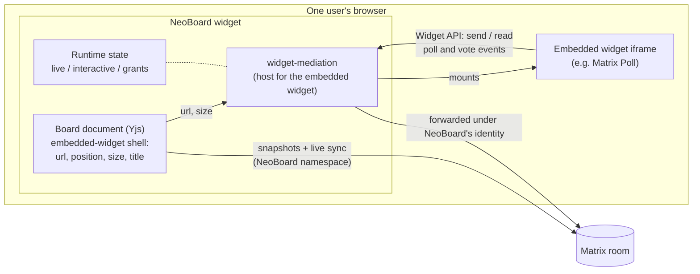
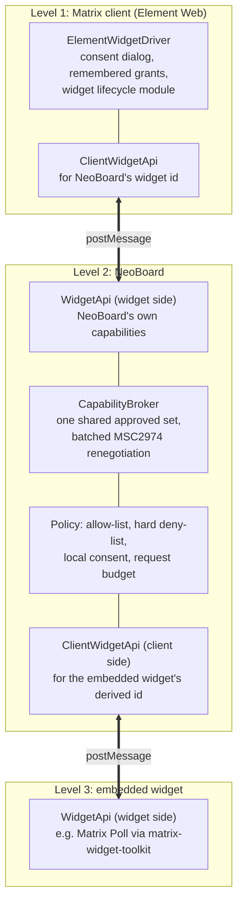
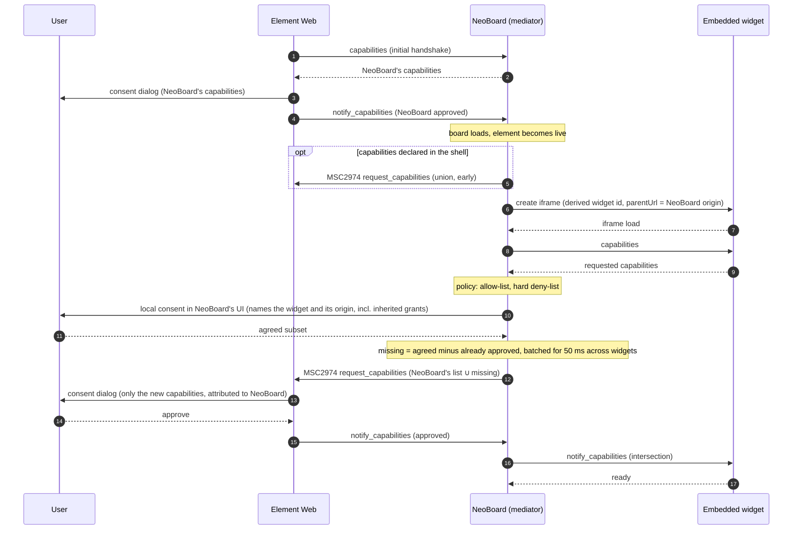
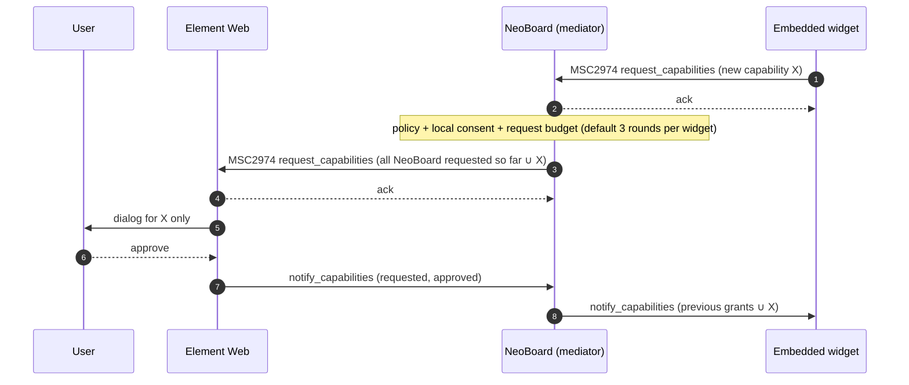
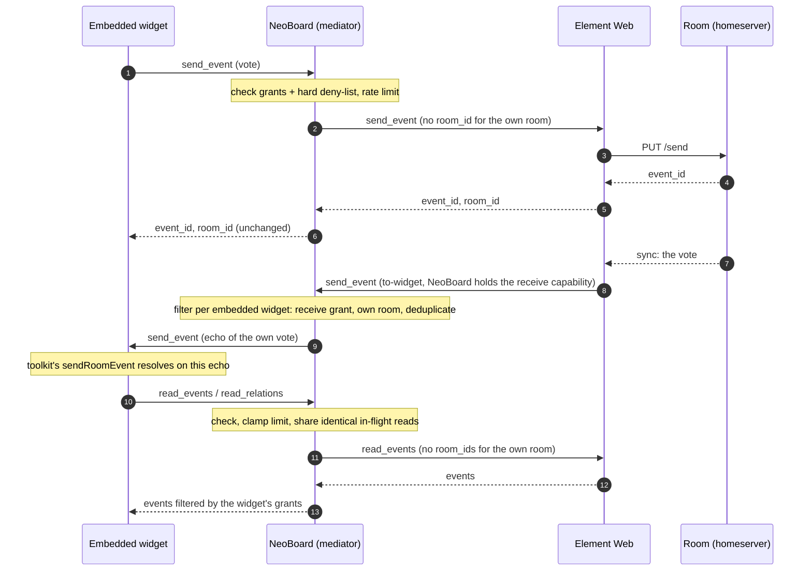
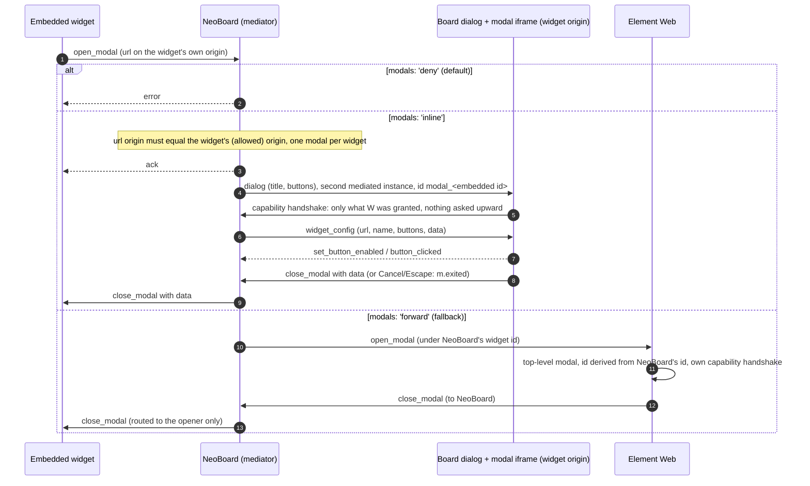
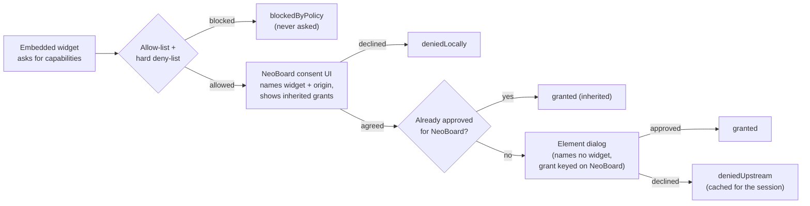
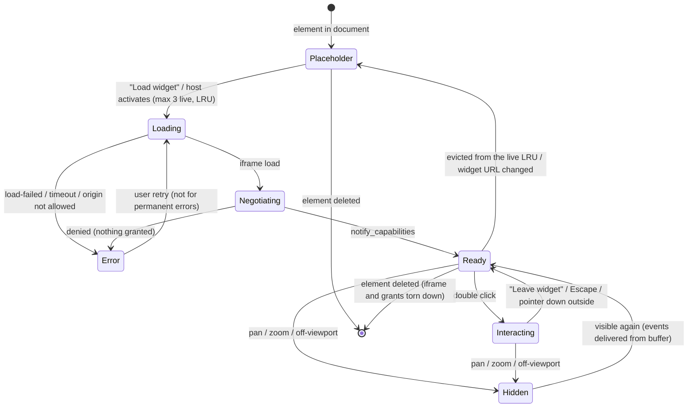
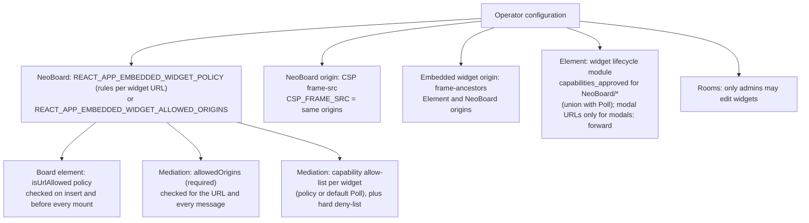

# NeoBoardception architecture

NeoBoardception lets a NeoBoard board contain _embedded widgets_: real Matrix
widgets (first case: Matrix Poll) that run inside a board element and can be
used by every board member. NeoBoard runs as a widget in a Matrix client
(Element Web). It is itself the widget host for the embedded widgets, so
there are three levels:

```
Matrix client (Element Web)  ->  NeoBoard (widget + host)  ->  embedded widget
```

This document covers the two state worlds, the three-level capability chain,
event and modal flow, consent, rate limits, the lifecycle of one embedded
widget and the deployment allow-lists. For the board element see
[`INTEGRATION.md`](INTEGRATION.md). For the host package see
[`packages/widget-mediation/README.md`](../packages/widget-mediation/README.md).
For the list of changes see [`HANDOFF.md`](../HANDOFF.md).

Status: the capability chain across two levels has been checked in a real
Element Web against a test widget, including MSC2974 renegotiation at
runtime. The board element and the mediation package are unit and
integration tested. Wired together, they ran a real Matrix Poll on the board
in Element Web (Gate 2, `HANDOFF.md` §5a). The operator policy for embedded
widgets (layer 2) is described in `HANDOFF.md` §5c. The hardened deployment
is described in [`hardening.md`](hardening.md) (German); its verification in
a real Element is open.

## 1. Two state worlds

The design depends on keeping two kinds of state apart.

| World               | What                                                                       | Stored in                                                        | Written by                                  | Seen by                                 |
| ------------------- | -------------------------------------------------------------------------- | ---------------------------------------------------------------- | ------------------------------------------- | --------------------------------------- |
| **Shell**           | Widget URL, position, size, title, declared capabilities, frame attachment | Board document (Yjs CRDT), persisted as NeoBoard snapshot events | NeoBoard (board editing)                    | Every board user, in real time          |
| **Content**         | Widget data, e.g. polls, votes, poll groups                                | Matrix room events of the widget's own types                     | The embedded widget, through the Widget API | Every room member whose widget reads it |
| **Runtime** (local) | Iframe, live/interactive state, focus, capability grants, view state       | React state and mediator memory of one client                    | That client                                 | Nobody else                             |



Rules:

- The shell never contains widget content. A vote is never written to the
  board document, and a poll is never stored in NeoBoard's namespace.
  `crdt.test.ts` and `EmbeddedWidgetDisplay.test.tsx` check that runtime
  state is not written to the document.
- The embedded widget never sees NeoBoard's own events. NeoBoard's
  document events are not on the embedded widget's allow-list, and a host
  should also deny its own namespace explicitly (`deniedCapabilities`).
- Moving, resizing, copying or deleting the element changes only the shell.
  Deleting the element does not delete the widget's room events, so a poll
  created in an embedded widget still exists in the room afterwards.
- Widgets that keep their shared state _inside_ the iframe (not in room
  events) do not fit this model: their state would be private to each
  viewer. This is a known conceptual limit.

## 2. The three-level capability chain



- **Element only knows NeoBoard.** Every grant, remembered selection and
  lifecycle-module pre-approval is keyed on NeoBoard's widget id or URL.
  The embedded widget is invisible to Element.
- **Union upward.** NeoBoard asks Element for its own capabilities plus the
  capabilities of all embedded widgets, as one MSC2974 renegotiation.
  `matrix-widget-api` always sends the full list the widget ever requested,
  so NeoBoard keeps its own grants. Element shows a dialog only for the
  capabilities that are new.
- **Intersection downward.** The embedded widget gets
  `requested ∩ allow-list ∩ approved by Element ∩ agreed locally`, minus the
  hard deny-list. A key-less state capability covers keyed requests, never
  the other way round.
- **`notify_capabilities` (MSC2871) is the answer on both levels.** Element
  tells NeoBoard what it approved; NeoBoard tells the embedded widget what it
  got. Toolkit widgets wait for this message before they report `ready`.

### 2.1 Initial negotiation



Only one renegotiation is in flight at a time: Element's
`notify_capabilities` carries no request id, so answers cannot be matched to
overlapping requests. Requests from several embedded widgets that arrive
within the batch window are merged, which turns N dialogs into one.
Denials are cached for the session, so a remount does not show the dialog
again; only an explicit user retry asks again.

### 2.2 Renegotiation at runtime (two levels)

An embedded widget may ask for more capabilities later (MSC2974). The
mediator handles this like the initial request and forwards it as a new
union renegotiation of NeoBoard's capabilities.



This path was checked in Element Web with a test widget: the second dialog
appears, only lists the new capability, and NeoBoard's own capabilities
survive the renegotiation for the rest of the session. No change to Element
or to the Matrix specification was needed. Matrix Poll itself does not
request capabilities at runtime in normal use (only in an error retry), so
for Poll the initial negotiation is the important path.

Two Element behaviours shape the UX (see
[`upstream-proposals.md`](upstream-proposals.md)):

- With "Remember my selection" checked, Element stores only the capabilities
  of the latest request. After a reload, Element asks for NeoBoard's own
  capabilities again.
- Element's dialog does not name the requesting widget ("This widget would
  like to…"). Even if it did, it would name NeoBoard, not the embedded widget.

## 3. Event flow



- **Up.** `send_event`, `read_events` (MSC2876) and `read_relations`
  (MSC3869) are forwarded through NeoBoard's own `WidgetApi`. A `room_id` is
  passed only for a foreign room. Element rejects explicit `room_ids` for the
  own room unless the widget holds a timeline capability, which NeoBoard
  should not request.
- **Down.** Element pushes events to NeoBoard because NeoBoard holds the
  union of receive capabilities. The mediator delivers each event to every
  embedded widget that may receive it. This must include the echo of the
  widget's own events: `matrix-widget-toolkit` resolves `sendRoomEvent` only
  when the echo arrives, so a missing echo makes "vote" and "start poll"
  hang. If no echo arrives within 5 s, the mediator sends a local copy
  marked `unsigned.local_echo` to the sending widget only.
- **`update_state`.** Toolkit widgets do not support `update_state`
  (MSC2762), so the mediator converts it to `send_event` and does not
  advertise it.
- **Paused widgets.** While an element is hidden (pan/zoom, off-viewport),
  the mediator buffers events and delivers them on resume, or reloads the
  widget if the buffer overflows.

## 4. Modal routing

Matrix Poll opens a modal widget to create and edit polls and groups
(`open_modal`). Per widget, the policy decides (`modals`): NeoBoard shows the
modal itself (`inline`), Element shows it top-level (`forward`), or it is
refused (`deny`, the mediation default).



- `'inline'`: Element never sees the modal. The modal widget is a second
  mediated instance in an accessible board dialog; its capabilities are the
  intersection of what it asks for with what the embedded widget was
  granted, so there is no further Element dialog and no lifecycle rule for
  the modal URL. Escape and the close button cancel (`m.exited`); removing
  or reloading the element ends the modal.
- `'forward'` lets the embedded widget open a top-level client modal. The
  modal runs its own capability handshake in Element, keyed on the modal URL,
  so a hardened deployment needs a lifecycle rule for each modal path.
- With `'deny'`, Poll can show and count votes but cannot create or edit
  polls inside the board.

The board takes the mode from the policy rule (`modals`). Without one,
origins in `REACT_APP_EMBEDDED_WIDGET_MODAL_ORIGINS` get `forward` and all
others `deny`.

## 5. Consent and identity



- Element's dialog cannot tell the user which embedded widget asks. Grants
  end up on NeoBoard's widget id.
- NeoBoard therefore shows its own consent step before anything is granted.
  The mediation package provides the hooks: `onCapabilityRequest` (who asks:
  name, origin, URL without query; which capabilities are inherited from
  NeoBoard and which need Element's dialog) and `confirmCapabilities` (the
  user's answer). The board's consent panel uses them. For widgets the
  operator pre-approved (`preload_approved` in the policy) the panel is
  skipped and a non-blocking notice names the widget and its origin.
- Capabilities NeoBoard already holds are never handed over silently. For
  example, both NeoBoard and Poll read `m.room.member`; Poll gets it only
  after the local consent step, because it reveals the member list to
  another origin.
- The embedded widget gets a derived widget id (`embedded-<element id>`) and
  only NeoBoard's origin as `parentUrl`, with no referrer.
- Embedded widgets must be operator-trusted and allow-listed. The mediator's
  policy reduces what a widget is offered and makes consent understandable.
  It is not a sandbox for untrusted third-party code.

## 6. Rate-limit budget

Embedded widgets send as the same Matrix user as NeoBoard, so they share the
user's homeserver rate limit (Synapse default `rc_message`: 0.2 events/s,
burst 10). NeoBoard itself already writes a snapshot (1 event plus one event
per 34 KB chunk) at most every 5 s while someone edits.

| Budget                     | Default                 | Where                                        |
| -------------------------- | ----------------------- | -------------------------------------------- |
| Per embedded widget        | burst 5, then 1 per 3 s | `mountEmbeddedWidget({ rateLimit })`         |
| All embedded widgets       | burst 8, then 1 per 2 s | `configureMediation({ aggregateRateLimit })` |
| Queued sends per widget    | 20                      | `maxQueuedSends`                             |
| State write coalescing     | same type + state key   | always on for queued writes                  |
| Capability rounds (dialog) | 3 per widget, min. gap  | `maxCapabilityRequests`                      |
| Timeline read limit        | 1000                    | `maxTimelineReadLimit`                       |

- Only live widgets send. Placeholders have no iframe, which avoids "every
  viewer mounts every widget and writes on load" storms.
- The aggregate default is above the Synapse default sustained rate. On
  homeservers with default limits, tune it down or raise `rc_message` for
  the users of the deployment. A measurement with several widgets is still
  open.
- Receive capabilities add downstream traffic: Element pushes those event
  types to every NeoBoard instance that holds them. Request capabilities only
  for widgets that are actually on the board.

## 7. Lifecycle of one embedded widget



| State       | Owner                     | Iframe  | Pointer events | Notes                                                              |
| ----------- | ------------------------- | ------- | -------------- | ------------------------------------------------------------------ |
| Placeholder | board element (React SDK) | none    | board          | Default. Also always used in slide thumbnails and PDF export.      |
| Loading     | mediation package         | yes     | none           | Waiting for `load` (30 s timeout).                                 |
| Negotiating | mediation package         | yes     | none           | `awaitingCapabilities` is set while a dialog is open.              |
| Ready       | mediation package         | yes     | none           | Widget usable; board pans and selects over it.                     |
| Interacting | board element             | yes     | widget         | Mouse and keyboard belong to the widget.                           |
| Hidden      | board element             | yes     | none           | Container hidden during gestures and off-viewport; events paused.  |
| Error       | mediation package         | removed | board          | `denied`, `load-failed` (incl. frame navigated away) or `timeout`. |

Teardown runs on React unmount, on eviction from the live list and when a
remote user deletes the element: timers and listeners are cleared, the
iframe is removed and pending capability waits resolve.

## 8. Deployment allow-lists

Nothing is embedded unless the operator configures it. Board users cannot
widen any of these lists.



1. **Origins.** Exact origins (scheme, host, port), `https` only, different
   from NeoBoard's own origin. With an operator policy (same schema as the
   widget lifecycle module, matched on origin + path without query and
   fragment), the origins of its rules; the origin variable then caps them. The board element checks the URL on insert and
   before mounting; the mediation package checks it again and pins every
   message to the frame and origin.
2. **Capabilities.** Exact strings by default. A hard deny-list that
   configuration cannot override covers widget registrations and layout,
   room administration state and redactions, other rooms, to-device,
   navigation, media, TURN, delayed and sticky events, and MatrixRTC. The
   only exemption is an explicit operator opt-in per widget URL
   (`matrixrtc: true`, plus `media_permissions` for the iframe `allow`) for
   a call widget such as Element Call: exactly the call capabilities of the
   user's own device, requested from Element only when such a widget loads.
   A running call pins its board element (never evicted by the live-widget
   cap, never paused while panning).
3. **Browser.** A CSP `frame-src` on the NeoBoard origin mirrors the origin
   list, so a code bug cannot widen it (widget-server image variable
   `CSP_FRAME_SRC`; without it every embedded widget is blocked). Embedded
   widgets should send `frame-ancestors` limited to the Element and NeoBoard
   origins.
4. **Element.** In hardened deployments, the widget lifecycle module
   pre-approves the union of NeoBoard's and Poll's capabilities (exact
   strings). Element asks the module on every capability request, including
   MSC2974 renegotiation, so users see no Element dialog, and since Element
   only stores "remembered" capabilities after a dialog, the remember problem
   does not occur. The current module (config key
   `io.element.element-web-modules.widget-lifecycle`, loaded at runtime)
   matches the raw widget URL including query and hash, so the rule needs a
   `/*` suffix. The module never denies: unlisted capabilities get Element's
   normal dialog; hard denial exists only in NeoBoard's mediation layer. The
   module cannot see which widget NeoBoard embeds; that is why the origin
   allow-list in NeoBoard must be in place before the Poll capabilities are
   pre-approved for NeoBoard.
5. **Rooms.** Restrict who may change widget registrations in managed rooms.

Details, pitfalls (rule ordering, wildcards, silent configuration errors) and
example configurations: [`hardening.md`](hardening.md) and
[`examples/`](examples/).
